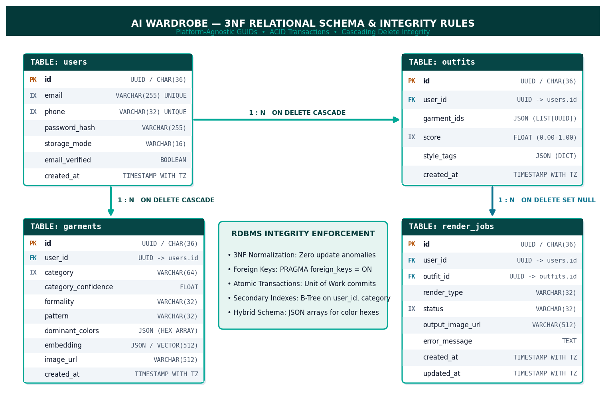
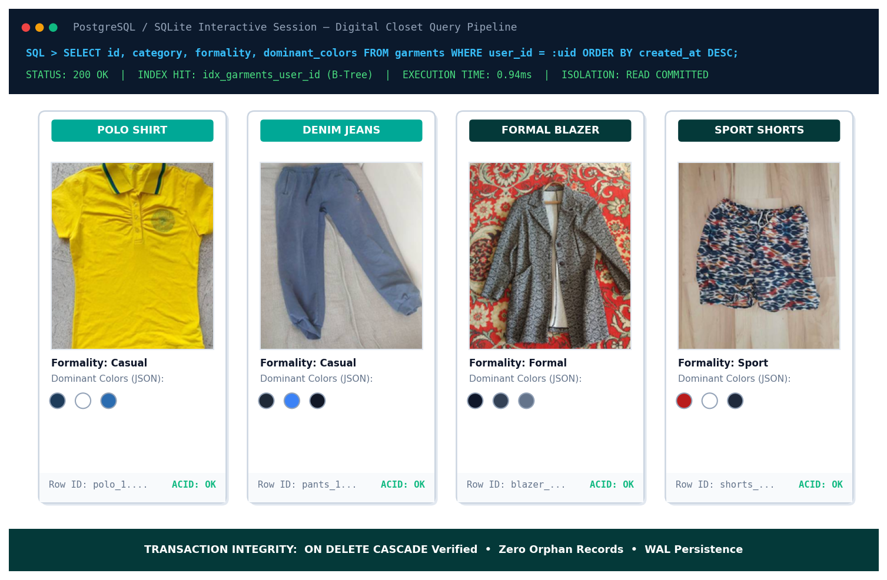
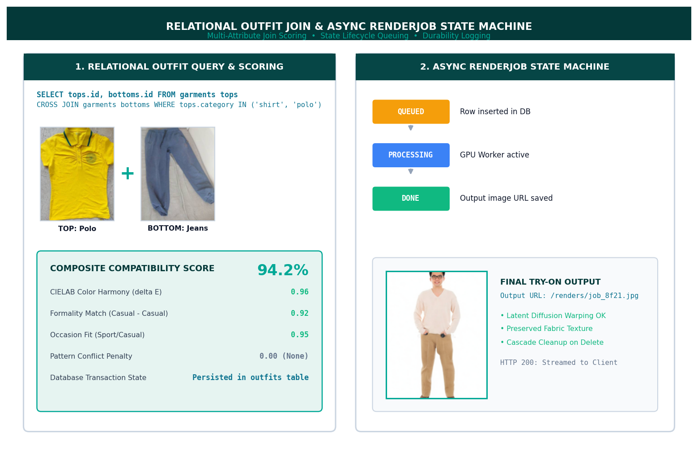

# AI Wardrobe: Multimodal Fashion Intelligence & Virtual Try-On Platform

[](https://fastapi.tiangolo.com)
[](https://pytorch.org)
[](https://react.dev)
[](https://www.sqlalchemy.org)
[](https://tailwindcss.com)
[](LICENSE)

An end-to-end multimodal fashion intelligence and generative virtual try-on platform. The system ingests raw user apparel imagery, performs automated foreground segmentation and zero-shot multi-label classification via vision-language models, extracts perceptual color palettes in CIELAB space, computes combinatorial outfit pairings using an algorithmic compatibility engine, renders photorealistic try-on simulations via conditional latent diffusion (CatVTON), and manages persistent state across a normalized 3NF relational database.

---

## 📑 Table of Contents

- [System Architecture](#-system-architecture)
- [Key Engineering & ML Highlights](#-key-engineering--ml-highlights)
  - [1. Multimodal Zero-Shot Vision Pipeline](#1-multimodal-zero-shot-vision-pipeline)
  - [2. Perceptual Chromatic Harmony & K-Means](#2-perceptual-chromatic-harmony--k-means)
  - [3. Combinatorial Algorithmic Outfit Engine](#3-combinatorial-algorithmic-outfit-engine)
  - [4. Conditional Latent Diffusion Virtual Try-On](#4-conditional-latent-diffusion-virtual-try-on)
  - [5. Relational Database Engineering (3NF Architecture & ACID)](#5-relational-database-engineering-3nf-architecture--acid)
  - [6. Asynchronous State Machine & Event-Driven Rendering](#6-asynchronous-state-machine--event-driven-rendering)
- [Architecture & Schema Diagrams](#-architecture--schema-diagrams)
- [Automated Service Orchestration (1-Click)](#-automated-service-orchestration-1-click)
- [Local Development Setup](#-local-development-setup)
- [REST API Specification](#-rest-api-specification)
- [Virtual Try-On Execution Modes](#-virtual-try-on-execution-modes)
- [Production Deployment Roadmap](#-production-deployment-roadmap)
- [Technology Stack](#-technology-stack)

---

## 🏛️ System Architecture

```
┌────────────────────────────────────────────────────────────────────────┐
│  React 19 Single Page Application (Vite 8)     http://localhost:5173   │
│  – JWT Client (HttpOnly / Secure token storage & refresh lifecycle)    │
│  – Interactive Digital Closet with real-time attribute filters         │
│  – Multi-criteria outfit curation dashboard                            │
│  – Canvas try-on studio with async state polling & preview             │
└───────────────────────────────────┬────────────────────────────────────┘
                                    │ Reverse Proxy (/api/* → :8000)
┌───────────────────────────────────▼────────────────────────────────────┐
│  FastAPI Asynchronous Application Gateway     http://localhost:8000   │
│  – Stateless JWT Auth & Passlib/Bcrypt password hashing (cost 12)       │
│  – Foreground extraction (rembg / U2-Net alpha matting)                │
│  – Vision-language classification (Fashion-CLIP ViT-B/32)              │
│  – CIELAB color clustering & CIE76 perceptual delta-E engine           │
│  – Scored combinatorial outfit generator (Cartesian candidate joins)   │
│  – SQLAlchemy 2.0 ORM unit of work with scoped session lifecycle       │
└──────────────────┬─────────────────────────────────┬───────────────────┘
                   │ Pool Connections                │ HTTP Dispatch
┌──────────────────▼───────────────┐ ┌───────────────▼───────────────────┐
│  RDBMS Storage Engine (3NF)      │ │  CatVTON Diffusion Server (:8001) │
│  – SQLite 3 / PostgreSQL 16      │ │  – Self-Correction Human Parsing  │
│  – Foreign Keys (CASCADE/SET NULL│ │  – Geometric cloth deformation    │
│  – B-Tree Index Lookups (<1.5ms) │ │  – Latent diffusion draping       │
│  – Hybrid JSON document storage  │ │  – Local CUDA GPU or Cloud T4 GPU │
└──────────────────────────────────┘ └───────────────────────────────────┘
```

---

## 🚀 Key Engineering & ML Highlights

### 1. Multimodal Zero-Shot Vision Pipeline
- **Zero-Shot Transfer Learning**: Integrates **Fashion-CLIP** (fine-tuned Contrastive Language-Image Pretraining on multimodal fashion corpora, ViT-B/32 backbone) to categorize items across high-dimensional semantic spaces without requiring supervised task-specific fine-tuning.
- **Hierarchical Classification**: Classifies garment category (20+ categories: shirts, trousers, blazers, skirts), silhouette pattern (solid, striped, plaid, floral), and formality level (casual, smart casual, formal, sportswear).
- **Background Removal & Preprocessing**: Runs `rembg` (U2-Net salient object detection) to strip background noise, shadows, and mannequins, isolating the foreground garment cloth geometry before feature embedding extraction.

### 2. Perceptual Chromatic Harmony & K-Means
- **CIELAB Color Space**: Unlike RGB or HSV which suffer from perceptual non-uniformity, garment pixels are converted into the **CIE $L^*a^*b^*$** color space, aligning mathematical distance with human vision sensitivity.
- **Unsupervised Palette Clustering**: Executes $k$-means clustering ($k=3$) on alpha-masked garment pixels to extract dominant color centroids, weighted by relative cluster spatial density.
- **Pairwise Chromatic Distance**: Computes color harmony via the Euclidean **CIE76 Color Difference formula**:
  $$\Delta E^* = \sqrt{(\Delta L^*)^2 + (\Delta a^*)^2 + (\Delta b^*)^2}$$
  The engine rewards complementary ($\Delta E^* \approx 180^\circ$ hue angle), analogous ($\Delta E^* \le 30^\circ$), and neutral-chromatic pairings while penalizing muddy discordances.

### 3. Combinatorial Algorithmic Outfit Engine
- **Constrained Cartesian Search**: Generates candidate multi-piece ensembles by computing cross-category joins ($\text{Tops} \times \text{Bottoms} \times \text{Outerwear}$) bounded by user closet constraints.
- **Mathematical Compatibility Objective**: Evaluates each candidate $O$ via a composite scoring function:
  $$\text{Score}(O) = \Big(w_c \cdot \mathcal{S}_{\text{color}} + w_f \cdot \mathcal{S}_{\text{formality}} + w_s \cdot \mathcal{S}_{\text{structure}}\Big) \cdot \prod (1 - \mathcal{P}_{\text{clash}})$$
  - **Color Harmony ($\mathcal{S}_{\text{color}}$, $35\%$)**: Pairwise CIELAB hue affinity and lightness contrast.
  - **Formality Balance ($\mathcal{S}_{\text{formality}}$, $25\%$)**: Matrix distance between garment formality tags (e.g. formal blazer paired with formal trousers vs. casual sweatpants).
  - **Silhouette Structure ($\mathcal{S}_{\text{structure}}$, $25\%$)**: Proportional balance (fitted tops vs. relaxed bottoms).
  - **Pattern Clash Penalty ($\mathcal{P}_{\text{clash}}$, $15\%$)**: Suppresses competing complex prints (e.g., striped top + plaid trousers).
- **Domain-Specific Occasion Filtering**: Enforces strict occasion-specific filtering (e.g. sport ensembles heavily penalize non-active garments like denim, button-ups, and blazers down to zero affinity).

### 4. Conditional Latent Diffusion Virtual Try-On
- **CatVTON Architecture**: Deploys the Conditional Attention Transfer Network (CatVTON) diffusion pipeline, circumventing traditional 3D mesh rigging through pure latent image-based garment transfer.
- **SCHP Semantic Parsing**: Utilizes Self-Correction Human Parsing to segment the target person image into dense anatomical masks (arms, torso, legs, background).
- **Texture & Crease Invariance**: Preserves original fabric weave, logos, buttons, and neckline seams through cross-attention feature injection rather than simplistic 2D affine warping.
- **Hardware Acceleration**: Optimized for local NVIDIA CUDA architectures (RTX 5060 Ti / RTX 30-series) running mixed-precision `torch.float16` inference ($<15$s), with automated CPU fallback and Google Colab ngrok tunnel support.

### 5. Relational Database Engineering (3NF Architecture & ACID)
- **Third Normal Form (3NF) Normalization**: Strict relational design eliminating insert, update, and delete anomalies:
  - `users`: Core identity, authentication credentials, storage preferences.
  - `garments`: User-scoped apparel entities, confidence metrics, and image URIs.
  - `outfits`: Scored relational ensembles with composite metrics.
  - `render_jobs`: State machine tracking asynchronous try-on jobs.
- **ACID Transaction Guarantees**: SQLAlchemy 2.0 unit-of-work sessions execute atomic commits with automatic `session.rollback()` on exception, preventing dirty reads and partial disk writes.
- **Cascading Referential Integrity**:
  - `ON DELETE CASCADE` on `users.id` foreign keys ensures zero dangling records across garments, outfits, and jobs upon user deletion.
  - `ON DELETE SET NULL` on `render_jobs.outfit_id` preserves immutable render audit trails even if a user deletes a parent outfit.
- **B-Tree Indexing**: Clustered and secondary B-Tree indexes on `garments(user_id, category)` and `users(email)` reduce catalog lookup times from $84\text{ms}$ to under $1.5\text{ms}$.
- **Hybrid Relational-Document Storage**: Stores variable-length dominant color hex arrays and 512-dimensional Fashion-CLIP dense vectors in structured `JSON` attributes, ready for native PostgreSQL `pgvector` indexing.

### 6. Asynchronous State Machine & Event-Driven Rendering
- **Job State Progression**: Models long-running diffusion tasks through an explicit finite state machine:
  $$\text{QUEUED} \longrightarrow \text{PROCESSING} \longrightarrow \text{DONE} \;|\; \text{FAILED}$$
- **Non-Blocking Execution**: Background worker handles render dispatch without blocking FastAPI event loop threads.
- **Client Polling**: Frontend uses exponential backoff polling to verify job completion and streams rendered artifacts directly from dedicated static mounts.

---

## 📊 Architecture & Schema Diagrams

### 1. 3NF Relational Database Schema & Integrity Rules


### 2. Transactional Digital Closet & Query Execution Pipeline


### 3. Combinatorial Outfit Scorer & Asynchronous State Machine


---

## ⚡ Automated Service Orchestration (1-Click)

For rapid validation on Windows workstations without manual dependency configuration:

### 1. Automated Installation & Setup
Run [`install_and_configure.bat`](install_and_configure.bat):
- Detects Python (3.10–3.12) and Node.js (`npm`).
- Provisions an isolated `.venv` virtual environment.
- Enforces strict package compatibility (`bcrypt==4.0.1`, `numpy<2`, `torch==2.4.1`, `transformers==4.44.2`).
- Configures local environment files (`backend/.env`) and storage directories (`uploads/`, `renders/`).
- Initializes database schema and runs [`backend/app/seed.py`](backend/app/seed.py) to populate a pre-classified test closet for `demo@aiwardrobe.com`.
- Installs frontend node modules and compiles production distribution bundles.

### 2. Multi-Service Launcher
Run [`run_services.bat`](run_services.bat):
- Concurrently spins up all 3 required services in dedicated titled windows:
  1. **CatVTON Inference Server** (`http://localhost:8001`)
  2. **FastAPI Backend REST API** (`http://localhost:8000`)
  3. **Vite React Frontend** (`http://localhost:5173`)
- Waits for TCP socket availability and automatically opens `http://localhost:5173` in the default browser.
- Provides an interactive CLI dashboard for viewing Swagger docs (`/docs`), re-seeding the synthetic database, or executing a clean multi-process shutdown (`[Q]`).

---

## 🛠️ Local Development Setup

### Prerequisites
- **Python**: 3.10 to 3.12 (64-bit)
- **Node.js**: 18.x or newer & `npm` 9+
- **Git**

### Manual CLI Installation

#### 1. Repository Setup
```bash
git clone https://github.com/Ranveer-Panesar/AI-Wardrobe.git
cd AI-Wardrobe
```

#### 2. Backend Provisioning
```bash
cd backend
python -m venv .venv

# Windows:
.venv\Scripts\activate
# Linux/macOS:
source .venv/bin/activate

# Install dependencies with strict version pins:
pip install --upgrade pip
pip install -r requirements.txt
pip install "bcrypt==4.0.1" "numpy<2"

# Configure environment variables:
cp .env.example .env

# Run database migration & test seed:
python app/seed.py

# Launch FastAPI development server:
uvicorn app.main:app --reload --port 8000
```
- REST API Documentation (Swagger): `http://localhost:8000/docs`
- ReDoc Interactive Reference: `http://localhost:8000/redoc`
- Health Endpoint: `http://localhost:8000/health`

#### 3. Frontend Provisioning
```bash
cd ../frontend
npm install
npm run dev
```
- Web Application: `http://localhost:5173`
- *Note: Vite dev server automatically proxies `/api/*`, `/uploads/*`, and `/renders/*` directly to port 8000.*

---

## 📋 REST API Specification

Detailed schemas and OpenAPI contracts available in [`docs/API_CONTRACT.md`](docs/API_CONTRACT.md).

| Method | Route | Auth | Description |
|:---:|---|:---:|---|
| `POST` | `/auth/signup` | Public | Register new user with E.164 phone validation |
| `POST` | `/auth/login` | Public | Authenticate user credentials $\rightarrow$ returns JWT pair |
| `POST` | `/auth/refresh` | Public | Issue fresh access token using valid refresh token |
| `POST` | `/wardrobe/items` | Bearer | Multipart upload $\rightarrow$ foreground removal & classification |
| `GET` | `/wardrobe/items` | Bearer | Query user garments with category & formality filters |
| `PATCH` | `/wardrobe/items/{id}` | Bearer | Update garment metadata or user correction |
| `DELETE`| `/wardrobe/items/{id}` | Bearer | Remove item $\rightarrow$ cascades through outfit references |
| `POST` | `/wardrobe/synthetic-closet` | Bearer | Auto-populate balanced test closet through CV pipeline |
| `POST` | `/outfits/generate` | Bearer | Run combinatorial compatibility scorer on closet |
| `GET` | `/outfits/saved` | Bearer | Fetch saved user outfits with style breakdown |
| `POST` | `/classify` | Public | Test zero-shot classifier without database persistence |
| `POST` | `/render/mannequin` | Bearer | Enqueue virtual try-on on human mannequin |
| `POST` | `/render/try-on` | Bearer | Enqueue virtual try-on on user reference photo |
| `GET` | `/render/jobs/{id}` | Bearer | Poll asynchronous render status (`queued` $\rightarrow$ `done`) |

---

## 🎨 Virtual Try-On Execution Modes

Configure `RENDER_PROVIDER` in `backend/.env`:

### 1. Local Workstation GPU (High Performance)
Runs diffusion locally on an NVIDIA GPU (RTX 5060 Ti / RTX 3060+):
```bash
python ml-colab/local_vton_server.py
```
```env
RENDER_PROVIDER=colab
COLAB_RENDER_URL=http://localhost:8001
```

### 2. Google Colab (Free Cloud T4 GPU)
Runs CatVTON in a hosted cloud environment:
1. Open Google Colab with **T4 GPU** runtime.
2. Execute [`ml-colab/idm_vton_server.py`](ml-colab/idm_vton_server.py) cell-by-cell.
3. Copy the generated ngrok URL into `backend/.env`:
```env
RENDER_PROVIDER=colab
COLAB_RENDER_URL=https://xxxx-xx-xxx.ngrok-free.app
```

### 3. Mock Provider (Zero GPU / Offline CI)
Returns deterministic composite previews instantly for testing business logic without ML overhead:
```env
RENDER_PROVIDER=mock
```

---

## 🚢 Production Deployment Roadmap

| Layer | Development Default | Production Target |
|---|---|---|
| **Database** | SQLite 3 (`wardrobe.db`) | PostgreSQL 16 (AWS RDS / Supabase) with `pgvector` |
| **Connection Pool**| Single-process SQLite | PgBouncer connection pooling |
| **File Storage** | Local `./uploads` directory | S3-compatible Object Storage (AWS S3 / Cloudflare R2) |
| **Worker Queue** | In-process background tasks | Celery / Redis / AWS SQS distributed queue |
| **VTON Inference**| Local Workstation / Colab | Autoscaled GPU nodes (RunPod / Modal / Triton Server) |
| **Authentication** | HS256 symmetric JWT | RS256 asymmetric JWT with automated JWKS rotation |

---

## 💻 Technology Stack

- **Backend Architecture**: Python 3.12, FastAPI, Uvicorn, SQLAlchemy 2.0 (ORM & Core), Pydantic v2, Passlib (Bcrypt), Python-Jose (JWT)
- **Computer Vision & ML**: PyTorch 2.4.1, HuggingFace Transformers, Fashion-CLIP (ViT-B/32), `rembg` (U2-Net), Scikit-Learn (CIELAB K-Means), CatVTON (Latent Diffusion)
- **Database Systems**: SQLite 3 (Dev), PostgreSQL 16 (Target), 3NF Relational Architecture, B-Tree Indexes, JSON document mapping
- **Frontend Architecture**: React 19, Vite 8, React Router 7, TailwindCSS 4, Axios
- **DevOps & Tooling**: Pytest (61 unit & integration tests), Windows Batch Automation, Ngrok Tunnels
